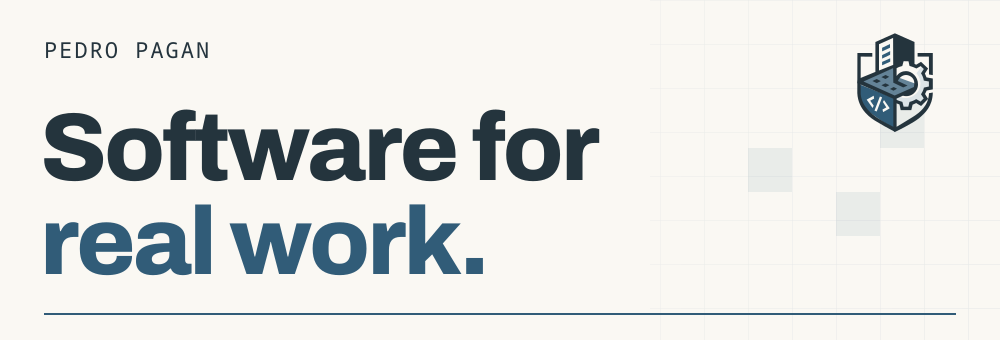

<a href="https://www.devpedropagan.com.br/">
  <picture>
    <source media="(prefers-color-scheme: dark)" srcset="./assets/profile-dark.svg">
    
  </picture>
</a>

**Full-stack developer & product lead · Amparo, Brazil**

I build software around the way people work, from business systems to tools I use every day.

At [Dogama](https://www.devpedropagan.com.br/dogama), I develop features, define product priorities and coordinate the team’s delivery. My work spans subscriptions, payments, logistics and the paths people take through the product. I build tools to understand that usage and use what I learn to guide the next change.

**[Explore my portfolio ↗](https://www.devpedropagan.com.br/)** · [LinkedIn](https://www.linkedin.com/in/devpedropagan/)

## Built around real work

### [Firmino](https://github.com/pedrinhopagan/firmino)

A personal secretary that stays on my desktop. One conversation brings together appointments, recurring routines, WhatsApp, email and the browser.

### [Motion Studio](https://github.com/pedrinhopagan/motion-studio)

A local studio I built to produce Dogama’s videos. I organize scenes and audio, leave review notes at precise timestamps, and keep render versions together.

[See the studio in action ↗](https://www.devpedropagan.com.br/motion-studio)

### [Koworker](https://github.com/pedrinhopagan/koworker)

A desktop workspace I built to keep projects, tasks and coding agent conversations together. Goals and decisions stay in Markdown files inside each project.

I now use **[T3 Code](https://t3.codes/)** for my day-to-day development. Building these tools taught me how to give agents useful context and keep their work reviewable.

> Good software should still make sense after deployment.
